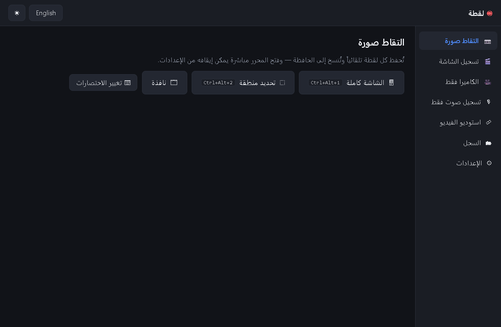
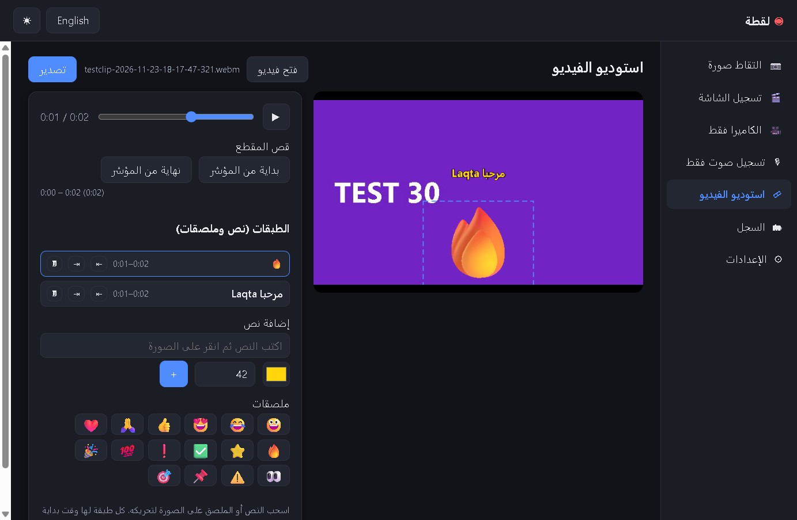
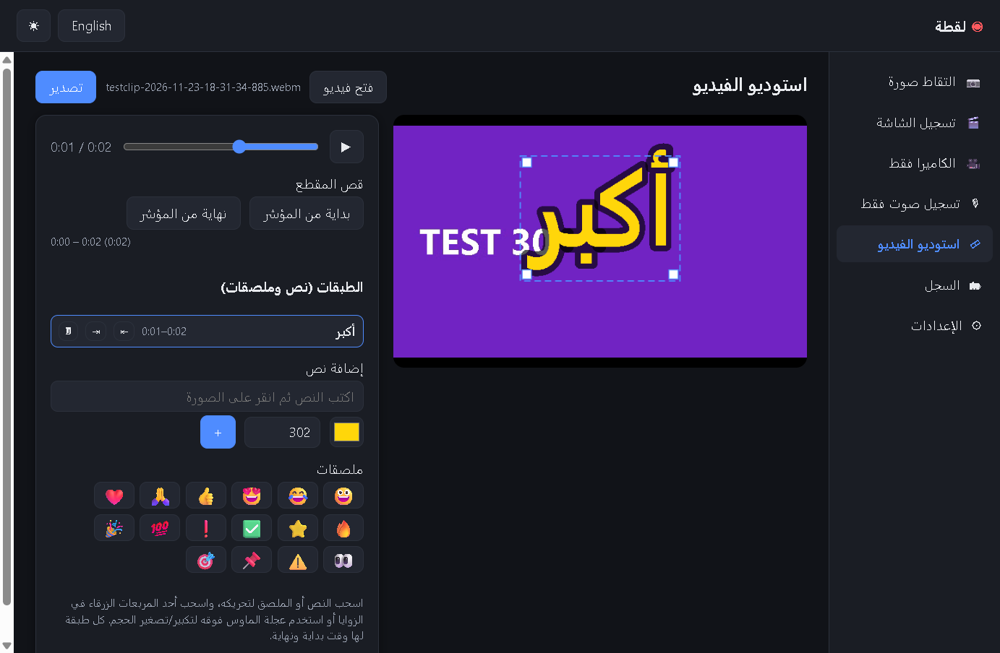
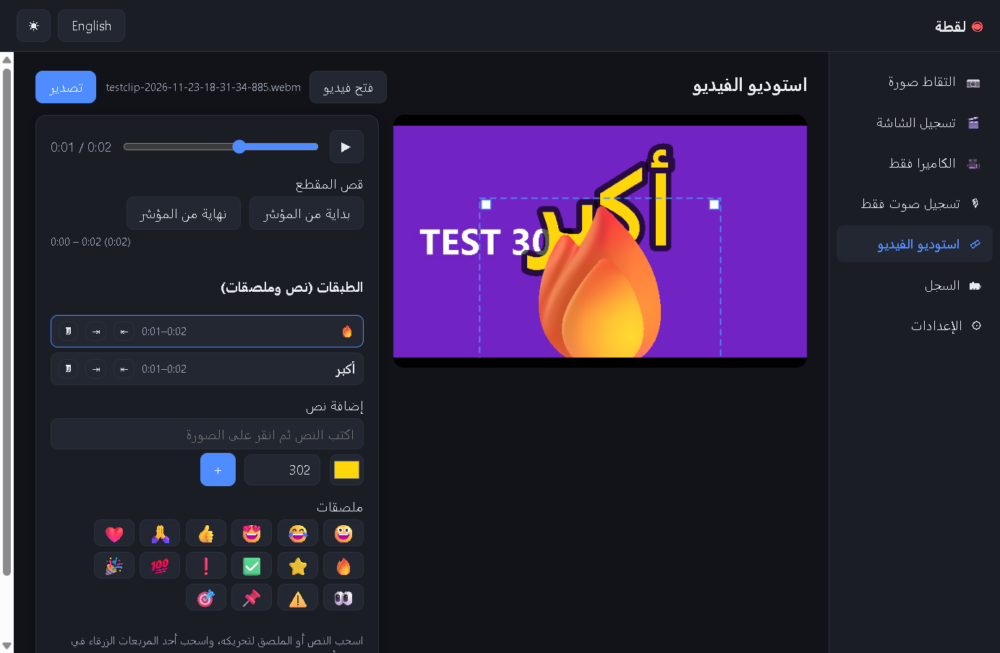
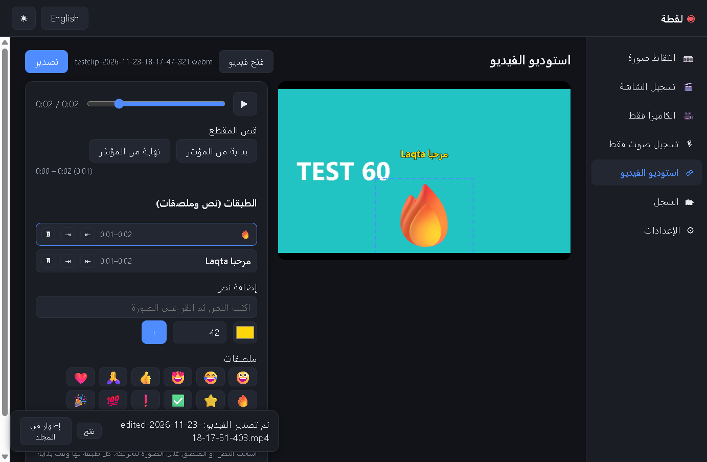

<div align="center">


# لقطة · Laqta

برنامج لقطات الشاشة وتسجيل الشاشة والكاميرا، مع استوديو تعديل فيديو — عربي/إنجليزي، وكل شيء يبقى على جهازك.

[](https://github.com/essa808/laqta/releases/latest)
[](LICENSE)
[](https://github.com/essa808/laqta/releases)
[]()

**[⬇ تحميل Laqta-win64.zip](https://github.com/essa808/laqta/releases/latest/download/Laqta-win64.zip)** — ويندوز 10/11 (64-bit) · محمول بدون تثبيت

</div>

## المزايا

- **لقطات شاشة**: الشاشة كاملة، منطقة محددة، أو نافذة — مع تأخير اختياري ومحرر (قلم، سهم، مستطيل، نص، تظليل، تمويه، تراجع) ونسخ تلقائي للحافظة.
- **تسجيل الشاشة**: مع صوت النظام والميكروفون، إيقاف مؤقت/استئناف، عد تنازلي، وإخفاء النافذة أثناء التسجيل.
- **الكاميرا فقط** وتسجيل الصوت فقط.
- **استوديو الفيديو**: قص المقطع، إضافة نص بلون وحجم، ملصقات وإيموجي، سحب وتحريك، تكبير/تصغير بسحب الزوايا أو عجلة الماوس، وتصدير MP4 بالصوت.
- **صينية النظام**: الإغلاق يُخفي البرنامج وتبقى الاختصارات تعمل، مع قائمة سريعة من الأيقونة.
- **خيارات**: تشغيل مع ويندوز، التقاط صامت (بدون فتح النافذة)، مجلد حفظ مخصص، اختصارات قابلة للتغيير، وضع داكن/فاتح، عربي/إنجليزي.

## لقطات

| الشاشة الرئيسية | استوديو الفيديو |
| --- | --- |
|  |  |

| تكبير النص | تكبير الملصق |
| --- | --- |
|  |  |



## التحميل والتشغيل

1. نزّل **Laqta-win64.zip** من [أحدث إصدار](../../releases/latest).
2. فك الضغط في أي مجلد.
3. شغّل `Laqta.exe`.

> التطبيق غير موقّع رقميًا، لذلك قد يعرض ويندوز تحذير SmartScreen عند أول تشغيل: اضغط **More info ← Run anyway**.

## التشغيل من المصدر

```bash
git clone https://github.com/essa808/laqta.git
cd laqta
npm install
npm start        # تشغيل البرنامج
npm test         # فحص الترجمة والاختصارات وتحويل إحداثيات القص
```

يتطلب Node.js 20+ وويندوز 10/11.

## الاختصارات الافتراضية

| الأمر | الاختصار |
| --- | --- |
| لقطة الشاشة كاملة | `Ctrl+Alt+1` |
| لقطة لمنطقة | `Ctrl+Alt+2` |
| بدء/إيقاف التسجيل | `Ctrl+Alt+R` |
| إيقاف مؤقت/استئناف | `Ctrl+Alt+P` |

كل الاختصارات قابلة للتغيير من الإعدادات (انقر الخانة ثم اضغط الاختصار الجديد).

## بنية المشروع

```
main.js        العملية الرئيسية: النافذة، الصينية، الاختصارات، الالتقاط والتسجيل
preload.js     جسر آمن بين الواجهة والنظام (contextBridge)
renderer.js    واجهة الالتقاط والتسجيل والسجل والإعدادات
studio.js      استوديو الفيديو: المعاينة، الطبقات، القص، التصدير
i18n.js        قاموس العربية/الإنجليزية وتحويل الاختصارات
index.html     واجهة التطبيق   ·   overlay.html/overlay.js  طبقة الكاميرا فوق التسجيل
win11menu/     إضافة قائمة الزر الأيمن (COM shell extension) لنظام ويندوز 11
test.js        اختبارات سريعة (تراجم، اختصارات، تحويل الإحداثيات)
```

## الخصوصية

لا حساب، لا رفع للسحابة، لا قياسات، لا علامة مائية، ولا حد للمدة. كل الملفات تُحفظ على جهازك في مجلد تختاره.

## الترخيص

[MIT](LICENSE) © 2026 essa808
